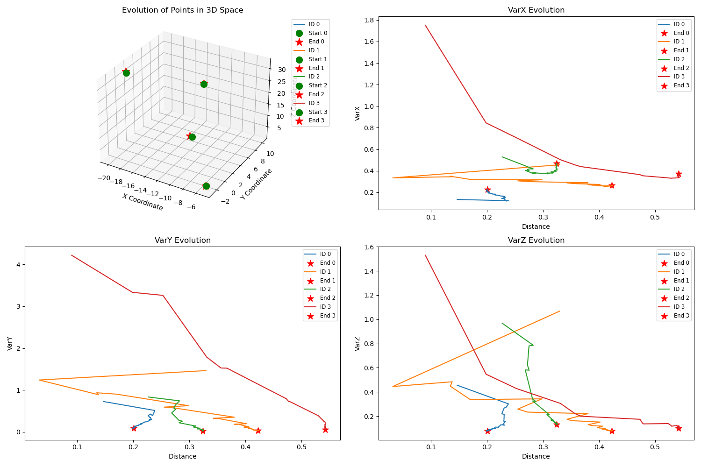
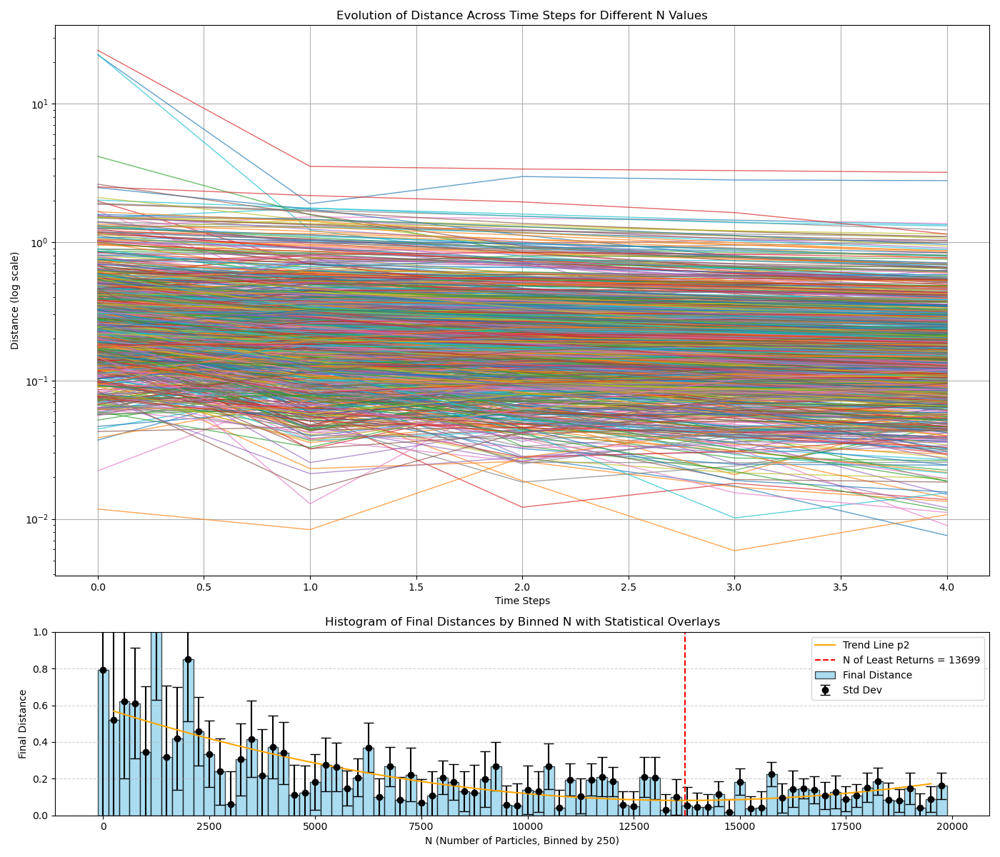
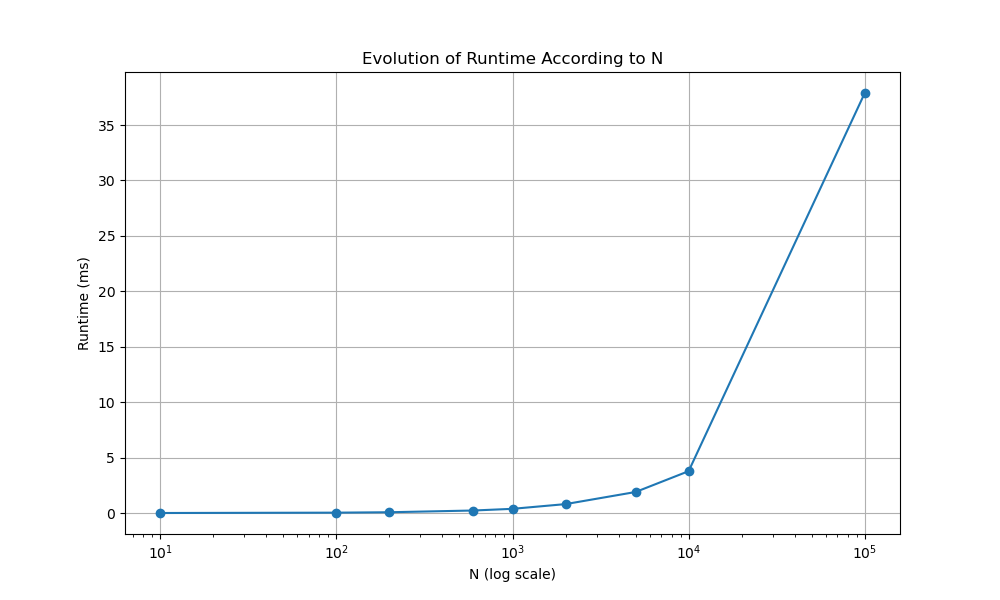
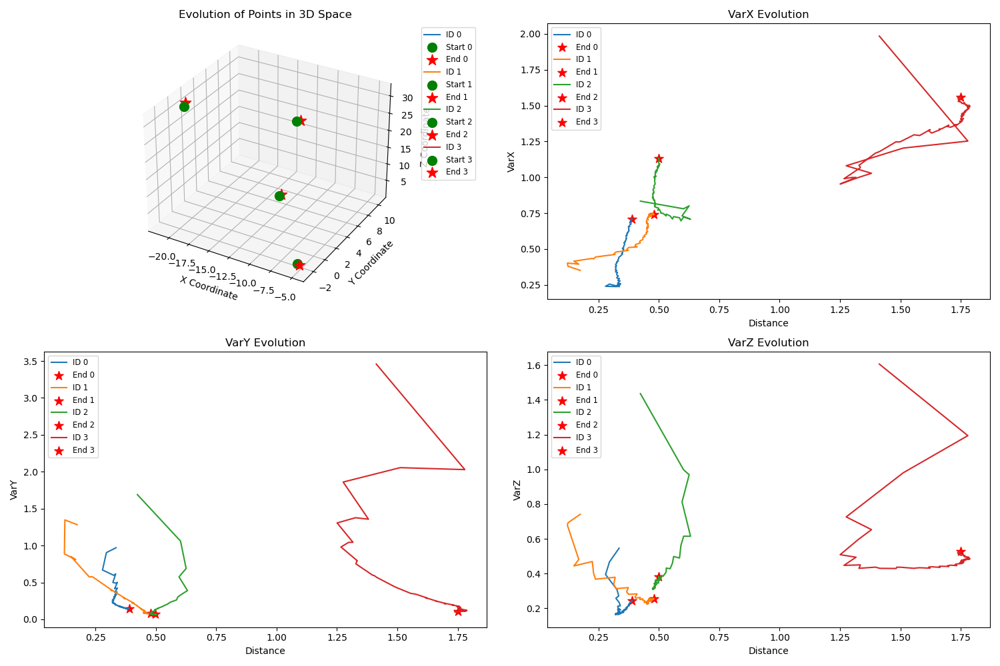
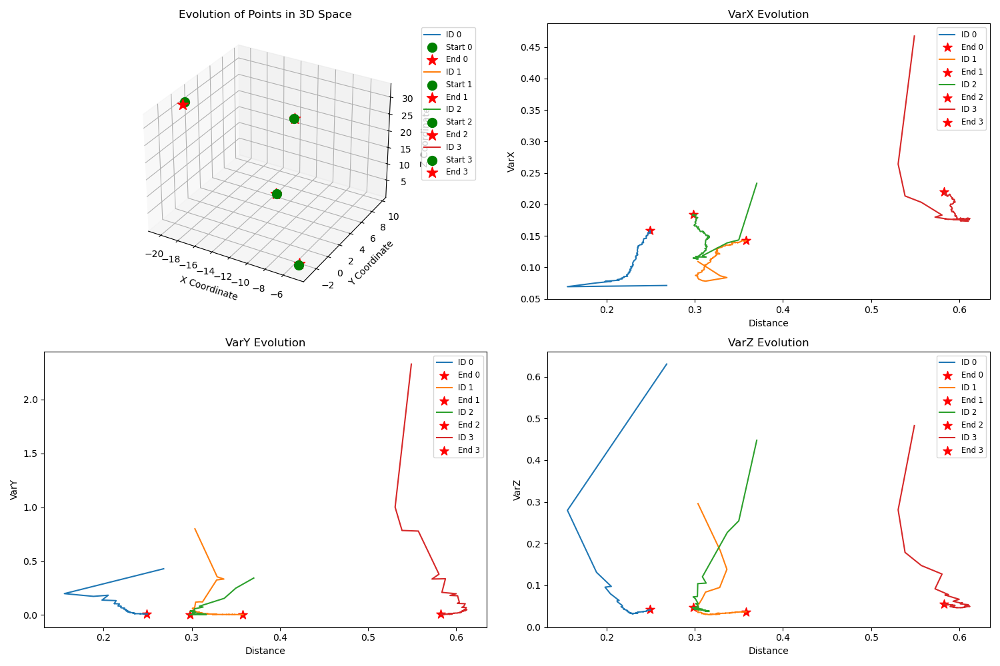
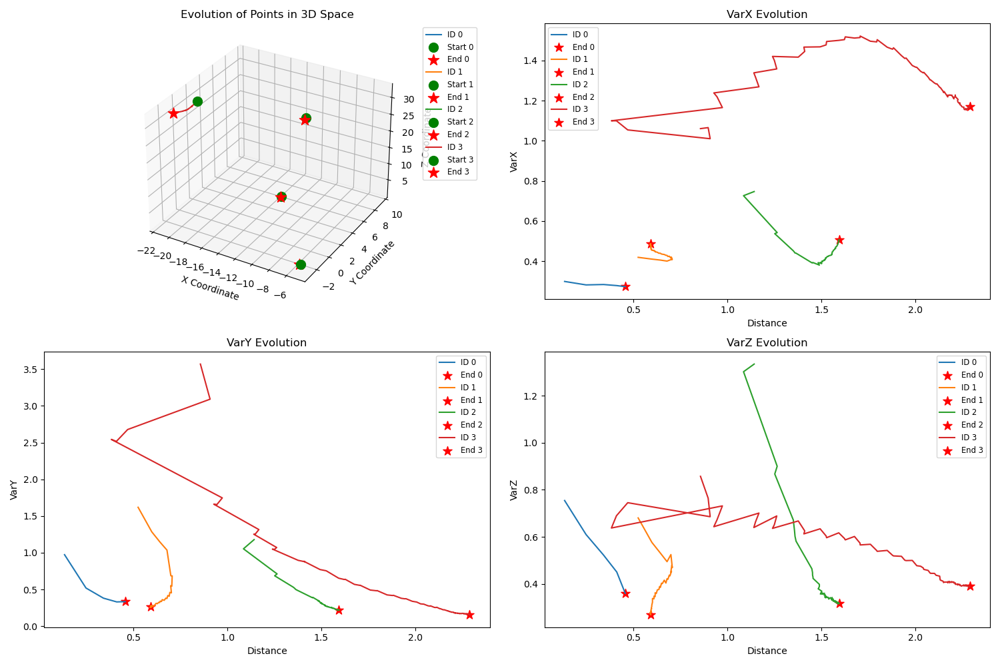
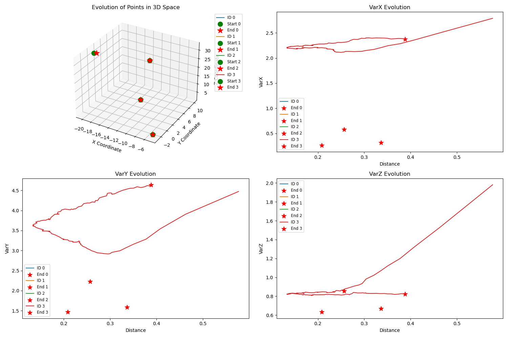
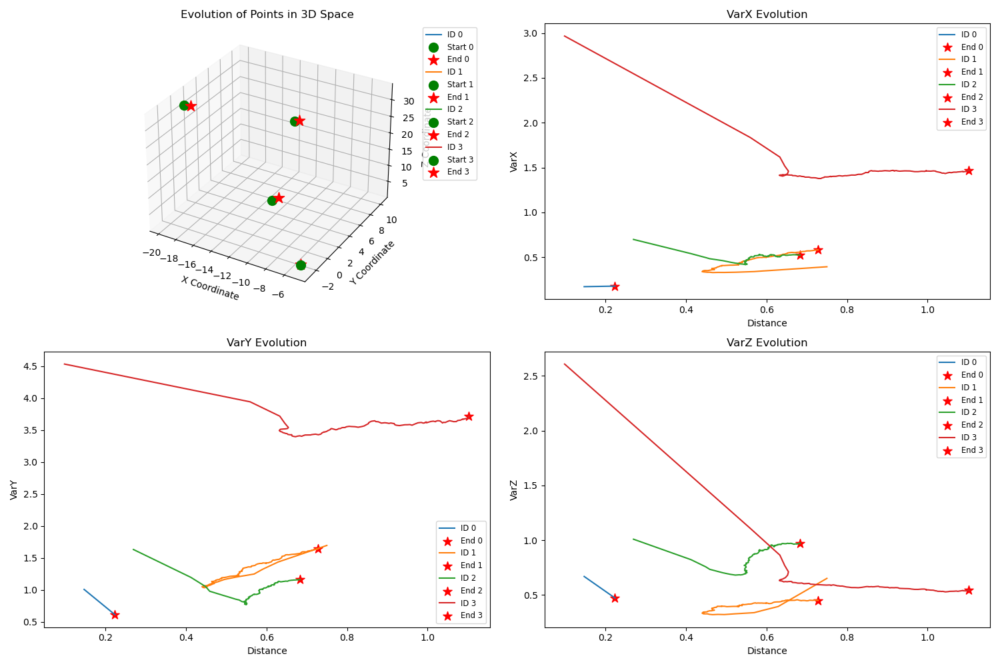
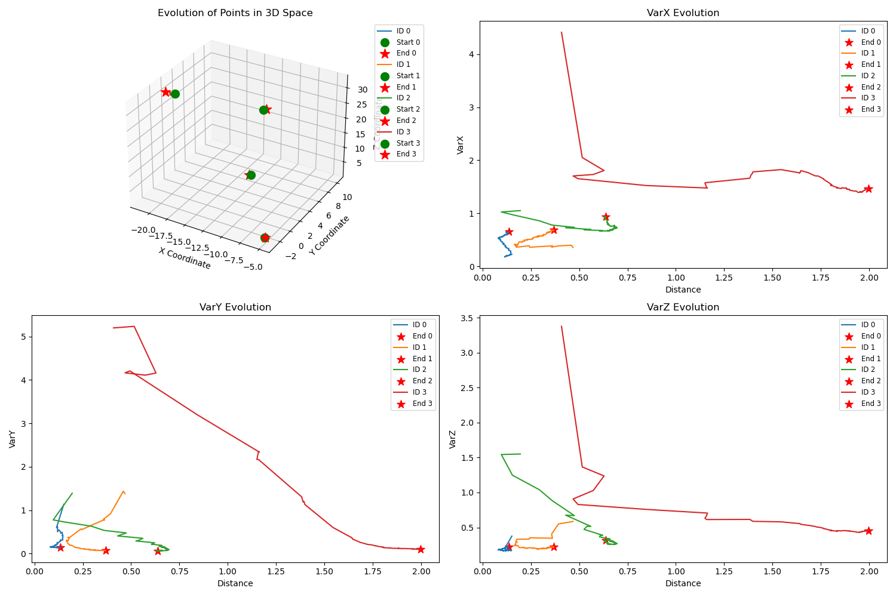

# analysis of the Filter behaviour

## Geometric convergence

The following showcases the evolution of the distance between estimates and real positions. In this test one round of updates are done to the anchors and then updates are only performed according to the mesh. This test uses a 1000 particles per filter, which is sub-optimal.

## Convergence according to N 

The following showcases the evolution of the distance between estimates and real positions according to the number of particles. 

## runtime

Here is the runtime according to the number of particules.

# strategies

## Best First

This strategy starts each round by ordering the particles according to their average variance. Then best nodes are updated first from the best particles.

## Worst first

This strategy starts each round by ordering the particles according to their average variance. Then worst nodes are updated first from the best particles.

## only better 

This strategy only perfomes updates to nodes that have a smaller avg variance then the particle.

## only worst

This strategy only perfomes updates to nodes that have a larger avg variance then others.

## only worst axis from better

This strategy only perfomes updates to nodes that have a larger avg variance then others, but only on the axis with the largest variance.

## random

This strategy randomly selects nodes to update.

